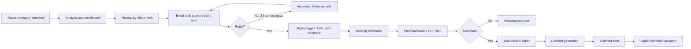

# Lead Intelligence: from Radar to Signed Contract (Email Outreach)

## Flow at a glance

Lead status values: `new → analysed → contacted → replied → meeting scheduled → proposal sent → proposal accepted / declined → deal closed` (or `do not contact` at any point).

## 1. Radar: the company enters
- **Connectors** collect public signals and news (funding, launches, growth). Each item creates a **company** and a **lead** with status **new**.
- AI identifies the company and whether it is a startup, then **enriches** it: website, country, sector, social profiles and the general email published on the website.
- Companies that asked not to be contacted, or that are already clients, are excluded.

## 2. Analysis: is it worth contacting?
- AI scores the lead (buying intent, fit with our services, quality of evidence, potential) and suggests the **service of interest**. Status becomes **analysed**.
- Alpha Tech decides in **Leads**: proceed, postpone or discard.

## 3. First contact by email
- AI writes a **draft** in the company's language. Alpha Tech reviews, edits and **approves** it.
- It is sent from Alpha Tech's email (SMTP) within a daily limit. Without SMTP, the message opens in Gmail instead.
- Status becomes **contacted**. If there is no reply after **3 business days**, a follow-up task is created (once only).

## 4. The client replies
- The dashboard reads the Gmail inbox over **IMAP, read-only**, every 3 minutes. Only messages from companies we already contacted are processed.
- A reply is saved on the lead, status becomes **replied**, follow-ups close, and it shows under **Today → Replies waiting**, with a red badge in the menu.
- A task "Give feedback" is created. If Alpha Tech answers from Gmail, the task closes automatically.
- Auto-replies and bounce notices are ignored. "Unsubscribe/remove me" requests set the company to **do not contact**.

## 5. Meeting
- In **Tasks**, Alpha Tech schedules the **meeting** with date and time. Status becomes **meeting scheduled**.
- The meeting syncs with **Google Calendar**.

## 6. Proposal (Documents page)
- Only clients with a scheduled meeting are eligible.
- Alpha Tech picks services, prices and terms. AI can suggest the text, but **prices always come from the form**.
- Alpha Tech downloads the PDF, sends it and marks it **proposal sent**. The client answers: **accepted** or **declined**.

## 7. Deal closed and contract (Clients page)
- Once accepted, status becomes **deal closed** and the company appears under **Clients**.
- The **contract generator** uses the proposal data (services, total value, payment schedule) in Portuguese, English or Spanish.
- Contract status: **draft → sent → signed**. After both parties sign, the **signed PDF** is uploaded (private storage in Supabase, up to 10 MB).
- The list highlights clients whose contract was sent and is **still awaiting signature**.

## Human control points
Alpha Tech approves every outgoing message, schedules every meeting, issues every proposal and contract. The system detects, analyses, drafts and records.
